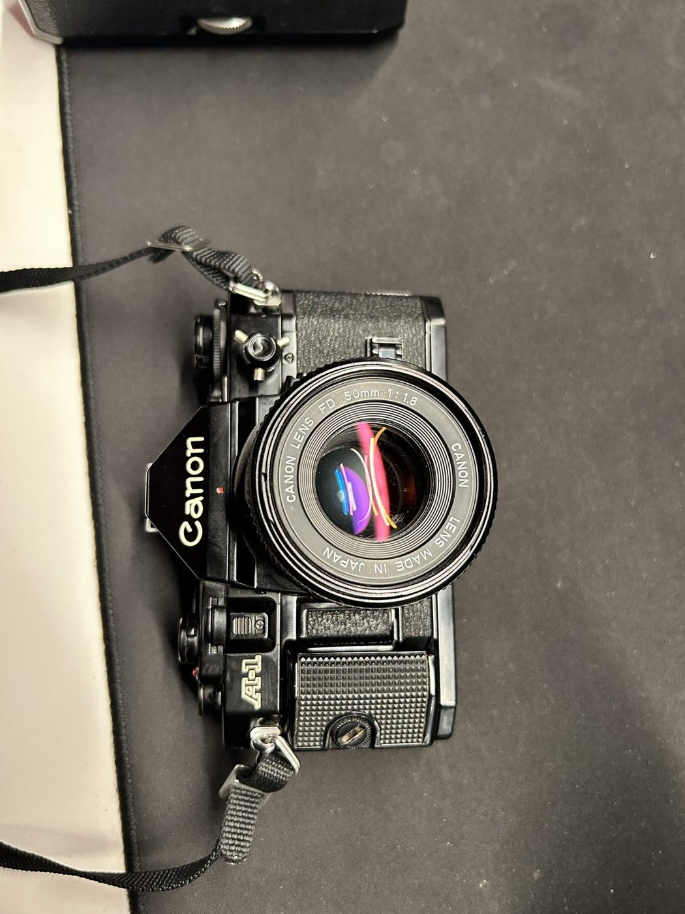

# Canon A-1 full refurbishment

**A step-by-step bench guide to taking a Canon A-1 apart, servicing it and putting it back together, plus the open-source shutter tester used to check the result.**

The Canon A-1 (1978) was the first SLR with fully programmed auto exposure, and it is still one of the best cameras of its era. Most surviving A-1s now need work: the famous mirror squeal, sticky shutter curtains, crumbling light seals, uneven exposure at fast speeds. Canon's service manual tells a trained technician what to do, but not what it looks like, and the hobby write-ups online skip the hard parts.

This repository is the record of one complete refurbishment, written up so someone else can follow it:

- **[The guide (PDF)](guide/Canon%20A-1%20Full%20Refurbishment%20Guide%20v1.pdf)**: 121 pages, 11 phases, 92 steps split into small one-action cards, with 255 photos from the actual teardown. Every screw is measured, every wire is labelled, and every step ends with a check and, where things can go wrong, a list of fixes to try in order.
- **[The shutter tester](shutter-tester/)**: Arduino firmware and a browser readout page for a two-sensor focal-plane shutter tester. It measures the exposure time on both sides of the frame and the travel time of each curtain, which is what you need to diagnose taper (one side of the frame brighter than the other) and set up the shutter properly. A phone app or a single-sensor tester can't do this.



## What's in the guide

| Phase | | Status |
|---|---|---|
| 0 | Baseline and inventory | Written from the manuals |
| 1 | Shutter diagnosis | Written from the manuals |
| 2 | Covers and top deck | **Photographed on the bench** |
| 3 | Front panel out | **Photographed on the bench** |
| 4 | Mirror box on the bench | Written from the manuals |
| 5 | Body and shutter service | Written from the manuals |
| 6 | Refit and test, covers off | Rebuild, illustrated with teardown photos |
| 7 | Curtain tension | Written from the manuals |
| 8 | VRT trim (count start) | Written from the manuals |
| 9 | Close up and cosmetics | Rebuild, illustrated with teardown photos |
| 10 | Final test and film | Written from the manuals |

Appendices: parts register with every fastener measured, log sheets to print, glossary, where the camera differed from Canon's manual, a true-size front leatherette template, and how to build the shutter tester.

> **Status: v1, work in progress.** The teardown (Phases 2–3) is fully photographed. The service, timing and rebuild phases are written from the Canon service manual and the author's measurements, and will get their own bench photos as the work is done. Each phase in the PDF says which kind it is. Read the unphotographed phases against your own camera before acting.

## The shutter tester

```
battery torch → lens mount → shutter → sensor plate (2 × BPW34 photodiodes, 30 mm apart)
            → LM393 comparator board → Arduino (edges timed to 4 µs) → USB → web page in Chrome
```

| Folder | What it is |
|---|---|
| `shutter-tester/firmware/ShutterTester/ShutterTester.ino` | Arduino sketch for Uno, Nano or Mega 2560. Timestamps every light/dark edge on D2 and D3, reports levels on A0/A1, one JSON line per shot over serial at 115200 baud. |
| `shutter-tester/shutter-tester.html` | The readout. Open it in **Chrome or Edge** (it uses Web Serial), click *Connect Arduino*. **Calibrate** tab: live levels and the 50 % threshold target per channel. **Measure** tab: exposure at A and B, error in EV, 1st and 2nd curtain travel, taper, history and CSV export. *Simulate* and *Demo shot* work without hardware. |

**Quick start**

1. Build the circuit (parts list, schematic and step-by-step build in Appendix F of the guide).
2. Open `ShutterTester.ino` in the Arduino IDE, pick your board and port, upload. Close the serial monitor afterwards.
3. Open `shutter-tester.html` in Chrome or Edge and click *Connect Arduino*.
4. Lens off, back open, sensor plate in the film rails, a battery torch shining into the mount. On B, hold the shutter open and set each channel's threshold to 50 % on the Calibrate tab.
5. Switch to Measure, tick *Binary speeds* for Canon A-series cameras (1/1000 is really 1/1024 s), and fire.

The tester works for any 35 mm camera with a focal-plane shutter; only the sensor spacing and the binary-speeds setting are A-1-specific.

## Sources

The guide cites, but does not reproduce, the Canon A-1 Repair Guide (C12-1601), the A-1 owner's manual, the Canon AE-1 Program service manual (curtain tension) and Eugene Pate's unofficial A-1 CLA notes. All photos, drawings and measurements in this repository are the author's own.

## Licence

- **Guide (PDF) and photos:** [CC BY-NC-SA 4.0](https://creativecommons.org/licenses/by-nc-sa/4.0/). Share and adapt it, credit the author, don't sell it, and share changes under the same terms.
- **Firmware and readout page:** [MIT](LICENSE).

## Disclaimer

This is a hobbyist's record, not a Canon procedure. Working inside a camera can damage it; the shutter curtains in particular are easily ruined by a fingertip or a drop of oil. You do this at your own risk.

## Author

Sipke Woudstra, 2026. Written up with help from Claude (Anthropic). Corrections and photos from your own A-1 are welcome as issues or pull requests.
